# ExoDoom

[](https://github.com/LordHerdier/ExoDoom/actions/workflows/ci.yml)
[](LICENSE)


ExoDoom is a bare-metal x86_64 (long mode) **exokernel** that runs Doom
([doomgeneric](https://github.com/ozkl/doomgeneric) + the
[Freedoom](https://freedoom.github.io/) IWAD) directly on QEMU with no
conventional OS underneath. The kernel only multiplexes hardware (physical
pages, framebuffer, disk extents, sound voices) and enforces who owns what.
Everything else, including the filesystem, the shell and Doom itself, runs in
ring 3 as a **LibOS** program.

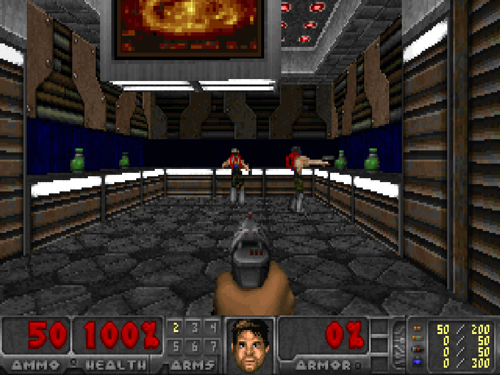

| | |
|---|---|
| 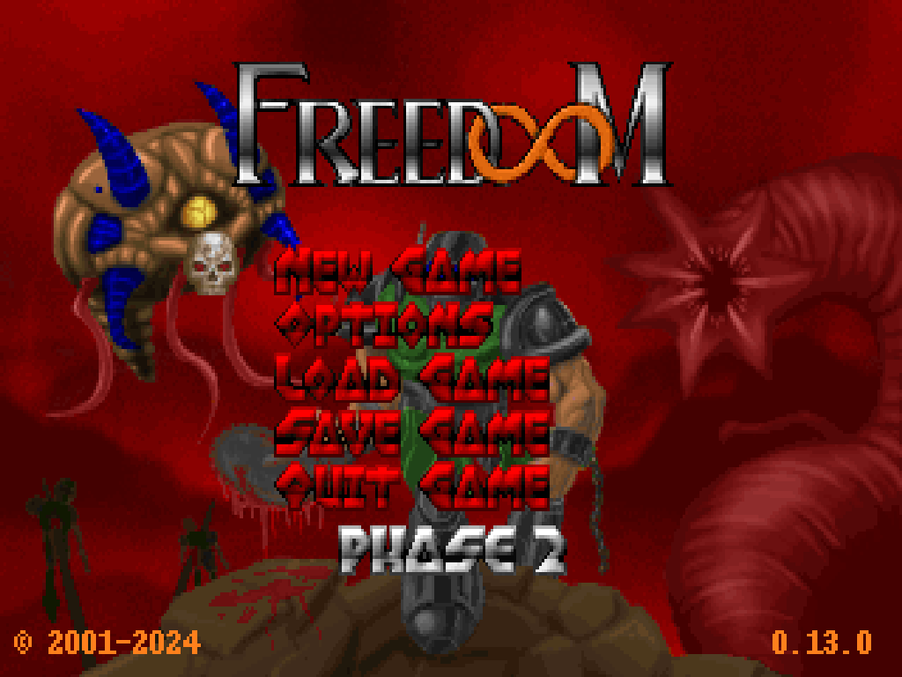 | 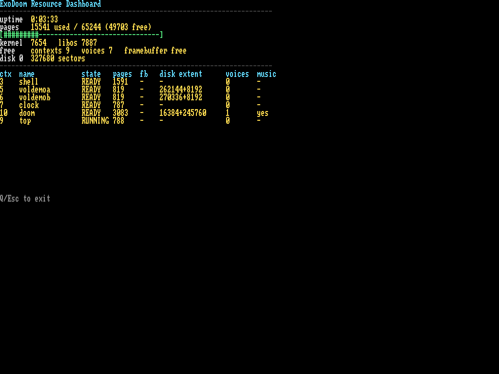 |
| Doom's title screen, rendered from the IWAD it reads over ExoFS | `top`, the live resource monitor, with Doom holding a disk extent and a sound voice |

## Contents

- [Quick start](#quick-start)
- [First boot walkthrough](#first-boot-walkthrough)
- [What's in the box](#whats-in-the-box)
- [Make targets](#make-targets)
- [Architecture overview](#architecture-overview)
- [Repo layout](#repo-layout)
- [Testing and debugging](#testing-and-debugging)
- [Documentation](#documentation)
- [Troubleshooting](#troubleshooting)
- [Third-party code and assets](#third-party-code-and-assets)
- [License](#license)

## Quick start

### Requirements

- **Docker** with `buildx` (Podman works if its `docker` CLI is compatible)
- **GNU Make**
- An internet connection for the first build (it downloads the GCC/binutils
  sources and the Freedoom release)
- *Optional:* `qemu-system-x86_64` on the host, to see the graphical display
  (see [Where the picture is](#where-the-picture-is))

No local cross-compiler is needed. The `x86_64-elf` toolchain, GRUB, xorriso
and QEMU all come from the Docker images.

### Clone, build, boot

```bash
git clone https://github.com/LordHerdier/ExoDoom.git
cd ExoDoom

make docker-build        # kernel + ISO + disk images -> build/
make run                 # build, then boot in a host QEMU window
```

The **first** `docker-build` compiles a full cross-toolchain from source and
takes about 15 minutes. Docker caches it, so later builds only recompile
ExoDoom.

`build/` then holds:

| File | What it is |
|---|---|
| `exodoom` | Kernel ELF (Multiboot 2) |
| `exodoom.iso` | Bootable GRUB ISO |
| `exodoom_disk.img` | System disk: the shell's scratch volume and the IWAD |
| `exodoom_disk2.img` | "Install disk": every `.exo` program plus `freedoom2.wad` |

Every build regenerates both disk images, so anything you saved or installed
inside the guest is gone after the next `make docker-build`.

### Where the picture is

ExoDoom draws to a VESA framebuffer, which a terminal can't show. Pick the
target that matches what you want to see:

| Target | Display | Use it for |
|---|---|---|
| `make run` | Real QEMU window on the **host** (SDL) | Seeing and playing everything. This is what the screenshots here come from. Needs `qemu-system-x86_64` on the host. |
| `make docker-run-kernel` | QEMU in a container, `-display curses`, serial on your terminal | Fast dev loop and reading serial logs. The framebuffer is not visible. |

`make run` plays audio through ALSA. If the host has no ALSA device (WSL, for
example), turn audio off:

```bash
make run HOST_QEMU_AV_ARGS="-display sdl -audiodev none,id=snd0"
```

In the curses targets, `Ctrl+A` then `X` quits QEMU, and `Ctrl+A` then `C`
opens the QEMU monitor.

## First boot walkthrough

The kernel boots, then launches the **shell** LibOS. Nothing is preinstalled on
the system disk, so you install the programs from the install disk yourself.
Use `make run-blank` (or `make docker-run-blank`) to start from an all-zero
disk and see this from the beginning. With plain `make run`, the system volume
already exists and you can start at step 2.

**1. Format the volumes.** A blank disk has no filesystem, so the shell offers
to format the **system volume**, where programs are installed. Press `y`.

The shell's own scratch volume, which `ls`, `cat`, `mkdir` and friends work
on, is separate and isn't formatted by that prompt. Until you run `mkfs`,
`ls` fails with `mount failed (run mkfs?)`. `mkfs` erases that volume, so run
it only on a fresh disk or when you want a clean slate.

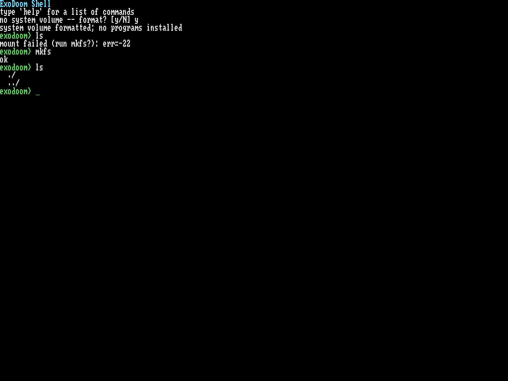

**2. Install the programs.** `install` copies packages from the install disk
(`/install`, device 1) onto the system volume. Run it bare to list what's on
the disk, then copy everything:

```
install            # list the install disk
install *          # every .exo program
install *.wad      # freedoom2.wad
```

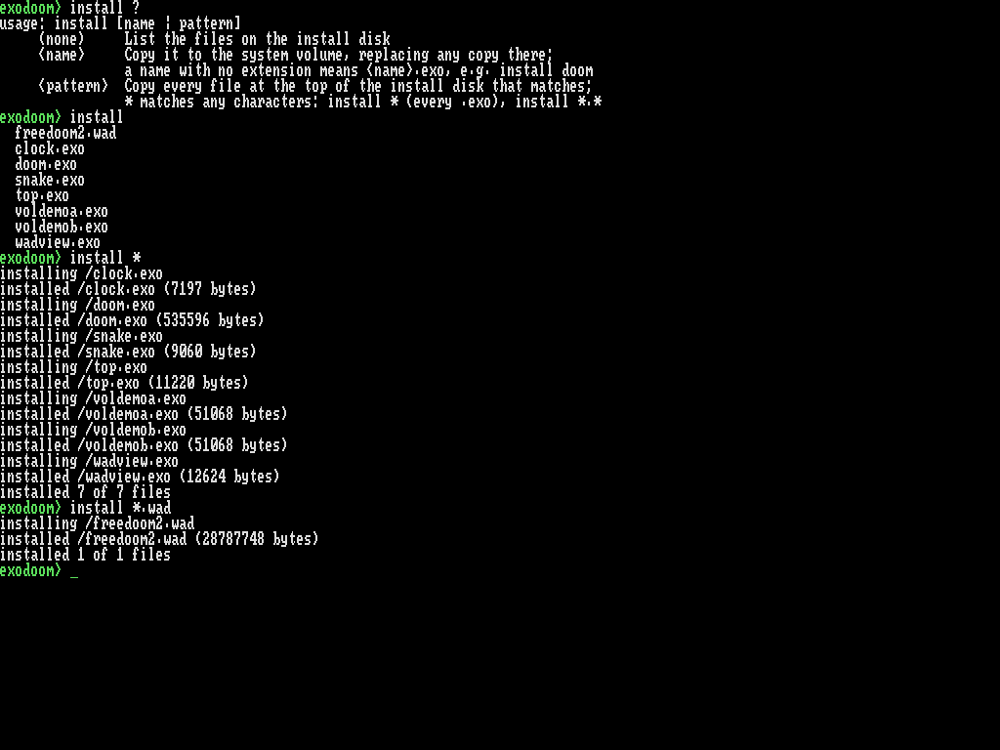

**3. Run something.**

```
programs           # what's installed
run doom.exo       # launch Doom
run snake.exo
run top.exo
```

Ctrl+Tab always switches back to the shell and leaves the program running.
`Q` or `Esc` quits most programs. Doom uses the standard Doom controls.

`help` lists the commands; `help all` lists all of them, grouped by area:

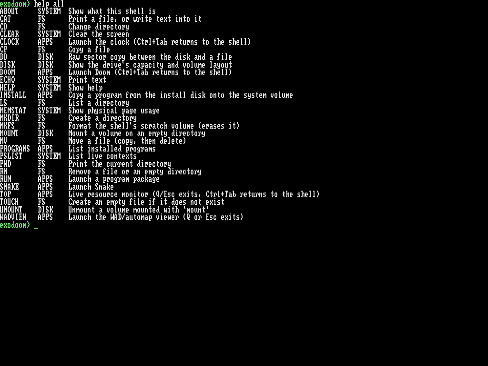

## What's in the box

All of these are separate ring-3 programs the kernel launches from `.exo`
packages. None of them can touch anything the kernel hasn't granted them.

| Program | What it shows | |
|---|---|---|
| `doom` | Freedoom 2 via vendored doomgeneric: framebuffer, keyboard, sound effects over the PCM mixer, OPL3 music over the stream syscalls, IWAD read over ExoFS |  |
| `top` | Live resource monitor: free pages, contexts, sound voices, and per-program pages, disk extent and voices |  |
| `wadview` | WAD flat browser and automap viewer, reading the IWAD directly | 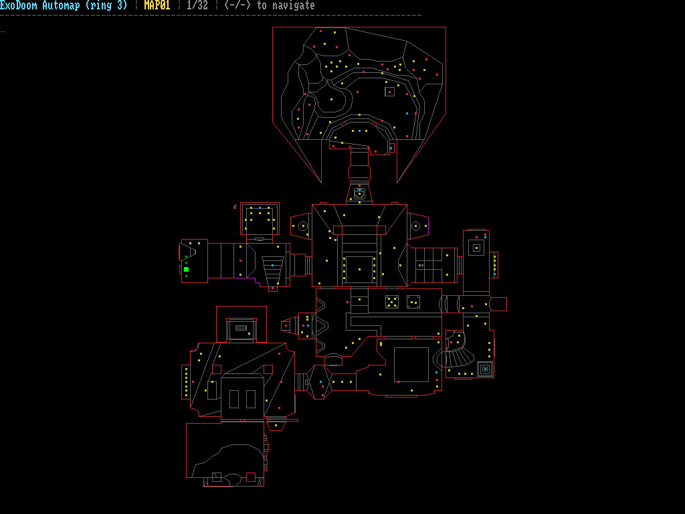 |
| `voldemoa` / `voldemob` | Two copies running at once, each bound to its own disk volume and **refused** (`-22`) when reaching for anyone else's | 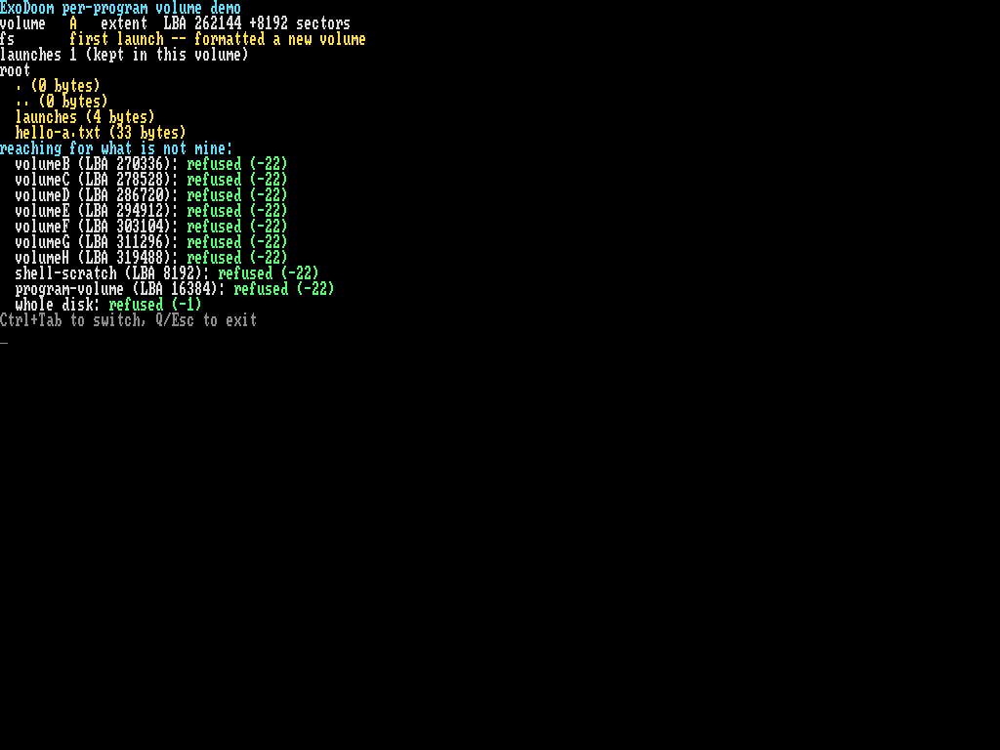 |
| `snake` | A small game that exercises input and the framebuffer | 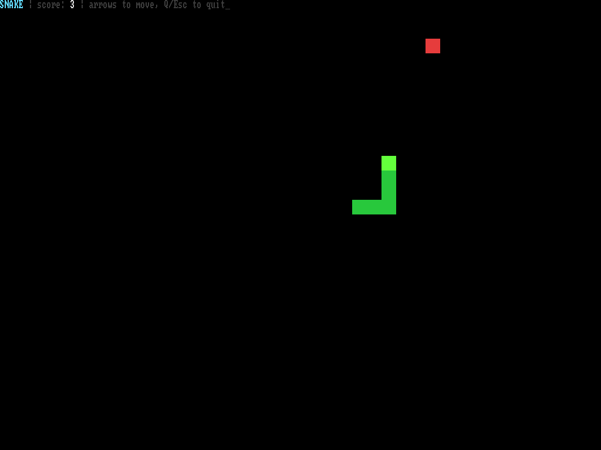 |
| `clock` | Wall-clock UTC from the CMOS RTC (`exo_rtc_read`) beside uptime |  |

The shell also has filesystem commands (`ls`, `cat`, `cp`, `mkdir`, `rm`, ...)
and `mount`/`umount`, which attach another disk's volume to an empty directory.
`disk` shows every volume and who is using it:

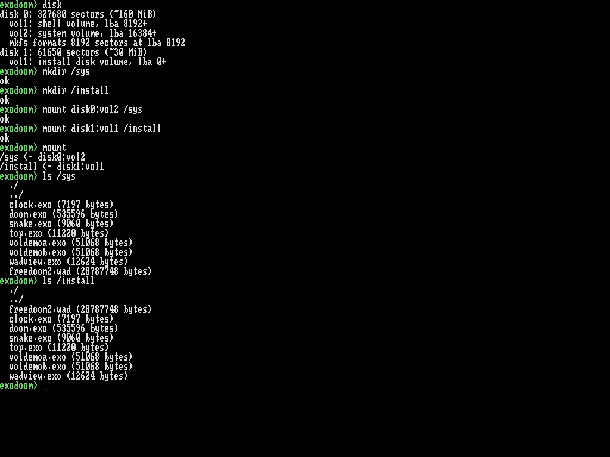

The flat browser, for the curious:

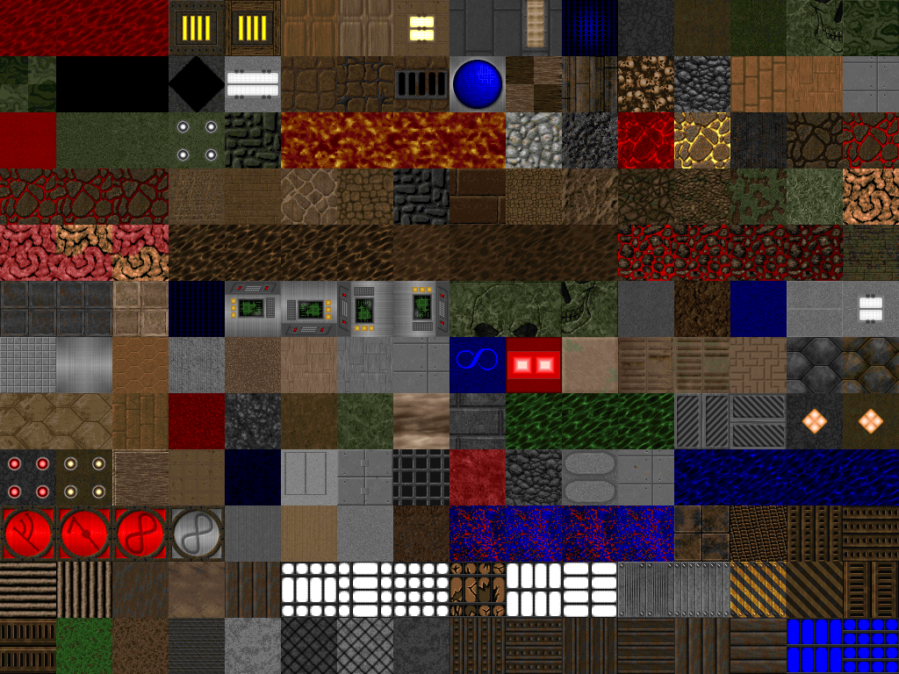

## Make targets

Every `docker-*` target begins by building the cross-toolchain image, so a
network failure there fails all of them and says nothing about your tree.

| Target | What it does |
|---|---|
| `make docker-build` | Build kernel, ISO and disk images into `build/` |
| `make docker-build DEBUG=1` | Unoptimized (`-g -O0`) build for GDB |
| `make docker-build AUDIO_PROFILE=1` | Compile in the audio timing reports (`docs/drivers/hda.md` §12.12) |
| `make run` | Build, then boot in a host QEMU window (SDL + ALSA) |
| `make run-blank` | Same, on a zeroed disk, to exercise the first-boot format prompt |
| `make demo-rehearse` | Build, then run the client demo unattended and check it (`docs/demo.md`) |
| `make docker-run` | Build, then boot in a container with the GRUB menu |
| `make docker-run-kernel` | Same with the GRUB menu skipped; the usual dev loop |
| `make docker-run-blank` | `docker-run-kernel` on a zeroed disk |
| `make docker-run-debug DEBUG=1` | Boot QEMU frozen at start with a GDB stub on port 1234 |
| `make docker-test` | Build with `TESTING=1`, boot, stream the serial test output |
| `make docker-ci` | Same as `docker-test`; what CI runs |
| `make docker-build-doom` | Compile-only gate over the vendored `src/doom/` |
| `make docker-link-doom` | Link gate: every libc symbol Doom needs resolves |
| `make clean` | `rm -rf build` |

The extra devices on every QEMU line (a second IDE disk standing in for an
install stick, three UHCI controllers, two USB keyboards, Intel HDA) are
explained in the comments at the top of the `Makefile`.

## Architecture overview

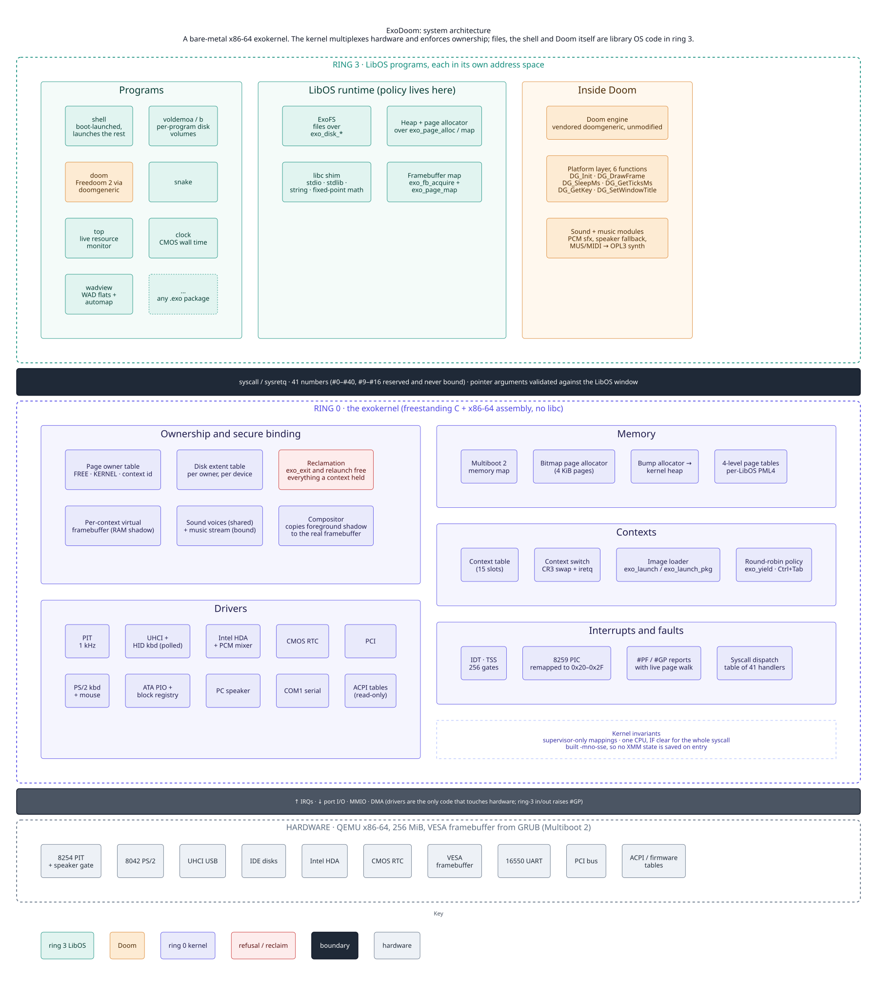

The other six diagrams, all in [`docs/diagrams/`](docs/diagrams/README.md):
[memory layout](docs/diagrams/02-memory-layout.svg),
[syscall flow](docs/diagrams/03-syscall-flow.svg),
[interrupt path](docs/diagrams/04-interrupt-path.svg),
[secure binding](docs/diagrams/05-secure-binding.svg),
[boot sequence](docs/diagrams/06-boot-sequence.svg) and
[context switch](docs/diagrams/07-context-switch.svg).

**Exokernel in one paragraph.** The kernel does not provide files, processes or
a heap. It exposes hardware resources and tracks which context owns each one
(a page, the framebuffer, a disk extent, a sound voice). A program asks for a
resource by syscall; the kernel checks and records the binding. Policy lives in
the LibOS. The filesystem, for instance, is a library over `exo_disk_read` and
`exo_disk_write`, and the kernel has no idea what a file is. When a program
exits, the kernel takes back everything it owned.

**Boot flow.** GRUB (Multiboot 2, asks for a VESA framebuffer) hands off to
`_start` in `src/boot.s`, which builds a 4 GB identity map, enables long mode
and SSE, and calls `kernel_main`. That sets up serial, the IDT and TSS, the
memory manager and ACPI tables, paging, the syscall gate, the PIC and PIT, PCI,
audio, ATA and USB, then the framebuffer and keyboard, and launches the shell
in ring 3. Under `TESTING=1` it runs the KUnit suite instead and exits QEMU.
The full sequence is in `docs/architecture.md` §4.

**Isolation.** Each LibOS runs in its own address space. Syscall pointers are
validated, kernel memory is mapped supervisor-only, and ring-3 `in`/`out`
instructions fault. The `voldemo` screenshot above is this enforced end to end:
two programs on the same disk, each locked to its own volume.

For the reasoning behind all of this, start with `docs/architecture.md`, then
`docs/syscall_spec.md`.

## Repo layout

| Path | Contents |
|---|---|
| `src/` | The kernel (C and x86 assembly, freestanding, no libc) plus its freestanding libc |
| `src/boot.s`, `src/kernel.c`, `src/linker.ld` | Multiboot 2 entry, `kernel_main`, link script (kernel at 2 MiB) |
| `src/vmm.c`, `page_alloc.c`, `memory.c`, `mmap.c` | Paging and physical memory |
| `src/idt.c`, `pic.c`, `isr.s`, `tss.c`, `fault.c` | Interrupts, exceptions, page-fault diagnostics |
| `src/syscall*.c`, `syscall_entry.s` | The `syscall`/`sysret` gate and one handler file per area |
| `src/fb*.c`, `disk_binding.c`, `revoke.c` | Resource ownership, secure binding, revocation |
| `src/ata.c`, `blkdev.c`, `usb*.c`, `uhci.c`, `hda.c`, `rtc.c`, `pci.c`, `acpi.c` | Drivers |
| `src/libos_fs/` | ExoFS, the filesystem, as **LibOS** code over `exo_disk_*` |
| `src/shell/` | The shell LibOS |
| `src/doom/`, `src/libos_doom/`, `src/doomgeneric_exo.c` | Vendored Doom engine, the `libos_doom` ring-3 target, platform layer |
| `src/libos_top/`, `libos_wad_viewer/`, `libos_snake/`, `libos_clock/`, `libos_voldemo/` | The other LibOS programs |
| `src/nuked_opl3/` | Vendored integer-only OPL3 synth used for Doom's music |
| `tests/kernel/` | KUnit tests, run inside the kernel at boot |
| `docker/` | `Dockerfile.build` (cross-toolchain), `Dockerfile.qemu`, `scripts/build.sh` and friends |
| `docs/` | Design docs (below) |
| `docs/diagrams/` | Architecture diagrams: D2 sources, rendered SVG and PNG |
| `tools/` | Small host-side helper scripts |
| `Makefile` | Entry point for everything above |

## Testing and debugging

Tests run **inside the kernel at boot**, not on the host, so there is no way to
run a single test file:

```bash
make docker-test        # full KUnit suite in one QEMU boot
```

The serial log ends in `ALL TESTS PASSED` or `TESTS FAILED`; CI greps for
exactly that. To add one, drop a `tests/kernel/test_<name>_k.c` file and
register its suite in `tests/kernel/test_runner.c`. See `docs/testing.md`.

For GDB:

```bash
make docker-build DEBUG=1
make docker-run-debug DEBUG=1     # QEMU waits on port 1234
```

then attach as described in `docs/debugging.md`. If you are chasing something
timing-dependent, run QEMU directly with KVM instead of through Docker:

```bash
qemu-system-x86_64 -m 256M -cdrom build/exodoom.iso -no-reboot -serial stdio -enable-kvm
```

COM1 serial is the only diagnostic and test channel. The framebuffer console is
for the user.

## Documentation

| Topic | Doc |
|---|---|
| Overview for readers new to the project: architecture, syscall table, isolation guarantees, design rationale | `docs/exokernel-architecture.md` |
| System design, boot sequence, LibOS/Doom path, build, roadmap | `docs/architecture.md` |
| Syscall ABI, ownership and revocation, sound | `docs/syscall_spec.md` |
| Paging, allocators, LibOS heap | `docs/memory.md` |
| ExoFS, `install`, `mount` | `docs/filesystem.md` |
| Writing a new LibOS program | `docs/libos-authoring.md` |
| The client demo, beat by beat, and its narration | `docs/demo.md`, `docs/demo-narration.md` |
| KUnit, writing and registering tests | `docs/testing.md` |
| GDB and bare-metal debugging | `docs/debugging.md` |
| Branches, commits, code style, CI checks | `docs/contributing.md` |
| Per-function libc audit | `docs/libc_audit.md` |
| Drivers (PIC, PIT, serial, ATA, PCI, ACPI, RTC, HDA, USB, ...) | `docs/drivers/*.md` |
| Diagrams: architecture, memory, syscall flow, interrupts, secure binding, boot, context switch | `docs/diagrams/README.md` |

New contributors: read `docs/contributing.md` first.

## Troubleshooting

- **Pressing Enter at the GRUB menu doesn't work.** Known issue. Use
  `make docker-run-kernel` or `make run`, which skip the menu.
- **`docker-build` fails on a `wget` step.** The toolchain download failed
  (mirror or network). It says nothing about your changes; rerun it.
- **`run doom.exo` says it can't find the IWAD, or `programs` is empty.** You haven't
  run `install *` and `install *.wad` yet, or you rebuilt, which regenerates
  the disk images.
- **`make run` fails with an ALSA error.** Use the `HOST_QEMU_AV_ARGS`
  override in [Where the picture is](#where-the-picture-is).
- **The screen is black under `docker-run-kernel`.** That target uses curses
  and can't show the framebuffer. Use `make run`.

## Third-party code and assets

- [doomgeneric](https://github.com/ozkl/doomgeneric) is vendored under
  `src/doom/` as the Doom engine (GPL-2.0, see `src/doom/LICENSE`).
- [Nuked-OPL3](https://github.com/nukeykt/Nuked-OPL3) is vendored under
  `src/nuked_opl3/` for music synthesis.
- `freedoom2.wad` isn't committed. `docker/scripts/build.sh` fetches it from
  the official [Freedoom](https://github.com/freedoom/freedoom) v0.13.0
  release on every build, verified against a pinned hash, and fails loudly on a
  mismatch. It's cached at `build/freedoom2.wad`. See `docs/architecture.md`
  §7 for the pin.

## License

MIT License (at least for now, may change later...?)
