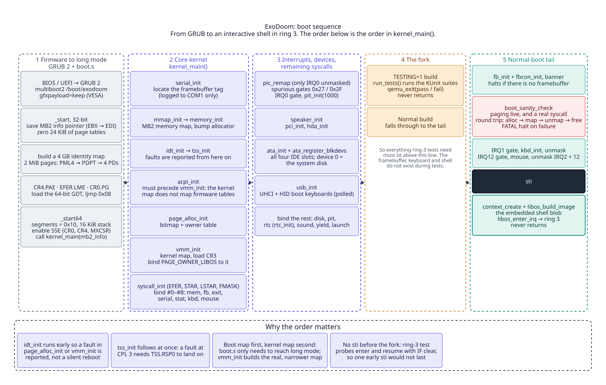
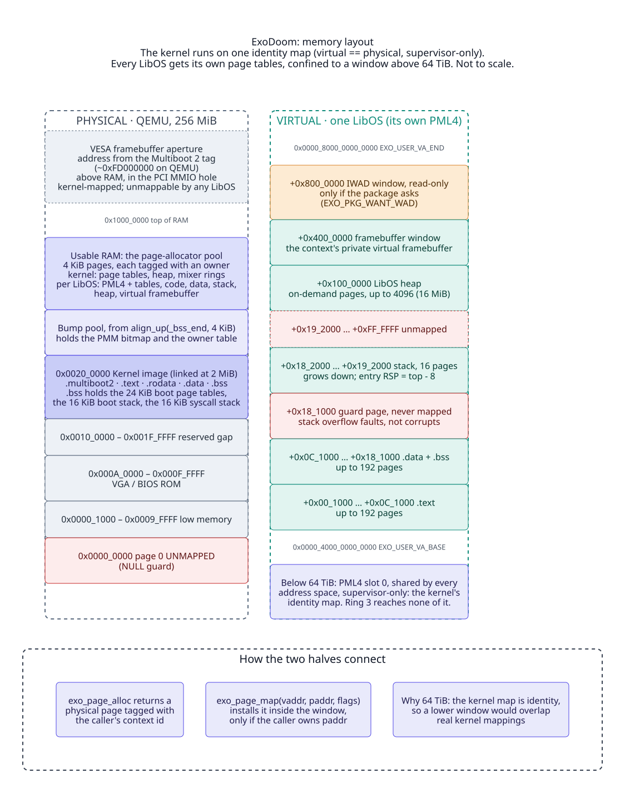
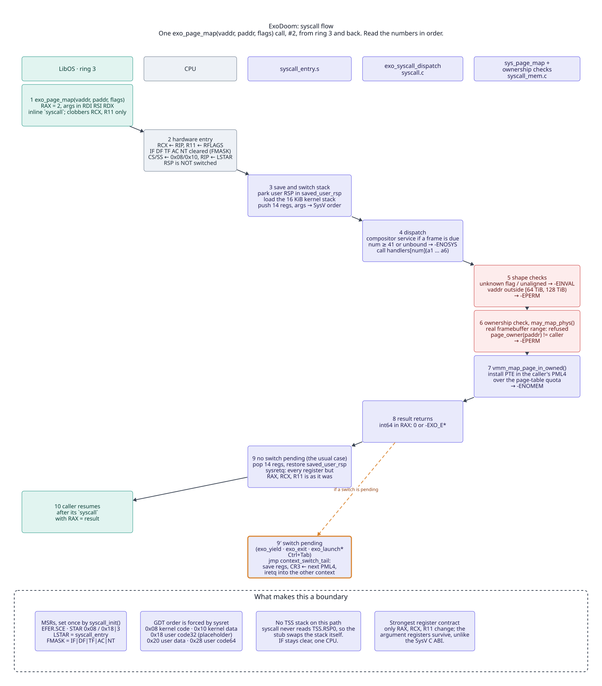
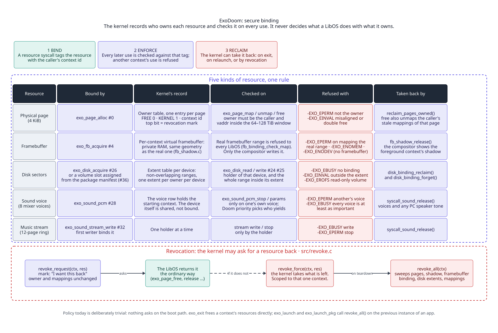
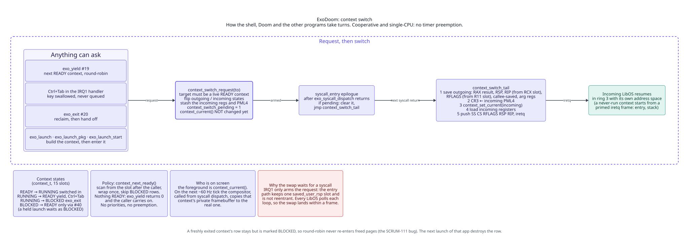
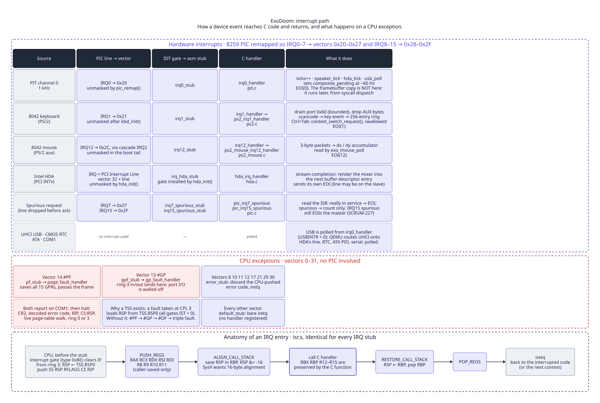
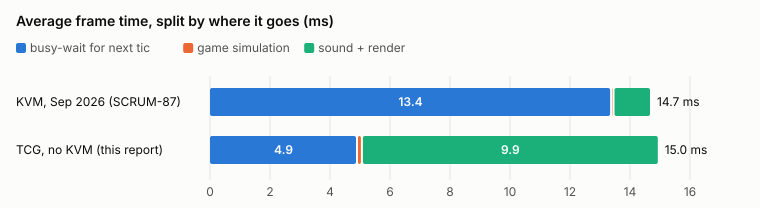
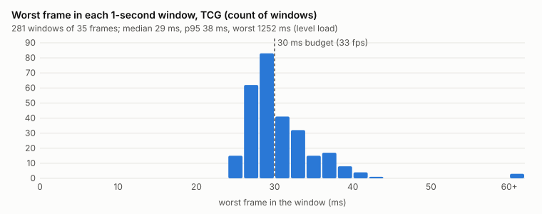
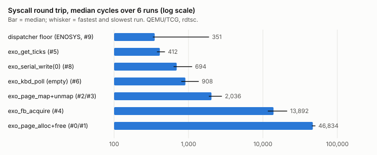
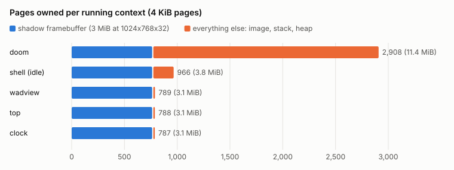

# ExoDoom: exokernel architecture, implementation and evaluation

**Audience:** the client, and anyone reviewing ExoDoom's design without
reading its code. This is the project's final architecture document. It
describes what was built (Part I), how it was built (Part II), how well it
works and what holds it to its promises (Part III), and why it was built this
way (Part IV). The team's working documents (`docs/architecture.md`,
`docs/syscall_spec.md` and the rest of `docs/`) carry the full detail and the
history; most sections end with a pointer to the one that goes deeper.

Describes `main` at commit `1f5474b`, 26 October 2026. Every figure in it was
taken from that tree, from the continuous-integration run on that commit
(run #924), or from the measurements in `docs/performance.md`.

---

## Contents

**Part I — Architecture**
1. Summary
2. The exokernel idea, applied
3. System architecture
4. Boot and memory
5. System-call interface
6. Isolation guarantees
7. Running several programs

**Part II — Implementation**

8. Code inventory
9. The kernel
10. The library operating system
11. Doom on the exokernel
12. Build, test and continuous integration

**Part III — Evaluation**

13. Isolation proof
14. Performance analysis
15. Functional results
16. Limitations and future work

**Part IV — Design rationale**

17. Design decisions and the alternatives they rejected

**Appendices**

A. System-call reference with error codes ·
B. Reproducing the evaluation ·
C. Glossary ·
D. Further reading

---

# Part I — Architecture

## 1. Summary

ExoDoom is a small operating-system kernel for 64-bit x86 PCs, written from
scratch in C and assembly, that boots on real hardware or QEMU and runs the
original Doom engine with no conventional operating system underneath it.

It is built as an **exokernel**. The kernel protects the machine's
resources (memory pages, the screen, disk sectors, sound voices, the CPU) and
hands them out. It does **not** decide how they are used. Everything a
conventional kernel would decide for a program instead lives in a library that
the program links in, a **library operating system (LibOS)**. A file system,
a memory allocator, a text console and the shell's program-admission policy
are all LibOS code in ExoDoom, not kernel code.

| | |
|---|---|
| Kernel | freestanding C and x86-64 assembly, no external libraries; 935 KiB image |
| System calls | 41 numbers, 33 bound; the rest are reserved and deliberately unbound (§5) |
| Programs | a shell, Doom, a WAD/map viewer, a clock, Snake, a live resource monitor (`top`), and a filesystem isolation demo, all ring-3 LibOS programs |
| Doom | the doomgeneric engine, 79 source files of which 4 carry small changes, on a 6-function platform layer and a C library shim (§11) |
| Multitasking | up to 15 programs at once, switched cooperatively; Ctrl+Tab brings another to the foreground |
| Tests | 101 suites, 1,108 tests and 88,158 assertions, run inside the kernel on every test boot, 0 failures on the final commit; the suite includes a 1,000,000-call random-argument syscall fuzzer (§13) |
| Performance | Doom averages 15 ms a frame (about 66 fps) against a 30 ms budget; a kernel round trip costs a few hundred CPU cycles (§14) |

---

## 2. The exokernel idea, applied

A conventional kernel abstracts the hardware behind rich interfaces (files,
processes, sockets) and makes the policy decisions behind them. An exokernel
separates **protection** from **management**. The kernel does only what must
be trusted: keep each program to the resources it was given, and get those
resources back when the program is done. A program's LibOS manages those
resources however that program needs.

| Decision | Conventional kernel | ExoDoom |
|---|---|---|
| Which physical page backs a virtual address | kernel | the LibOS asks for a page, then maps it where it wants |
| What a file is | kernel file system | ExoFS, a LibOS library; the kernel knows only sectors |
| How the heap grows | kernel `brk`/`mmap` | the LibOS heap pulls pages one at a time |
| Whether a program can be admitted | kernel | the shell compares the program's stated needs against free resources the kernel reports |
| What is drawn on screen | kernel console or window system | each program draws into its own framebuffer; the kernel only shows the foreground one |
| How sound effects are mixed into channels | kernel or sound server | Doom's LibOS picks voices, volumes and panning; the kernel mixes and plays |

The kernel stays small and its rules stay few, and a program can do something
unusual (Doom's custom music synthesiser, for example) without a kernel
change.

---

## 3. System architecture


Four layers, top to bottom:

- **Programs (ring 3).** The shell and the applications. Each one is linked
  with the LibOS pieces it needs and runs in its own address space.
- **LibOS (ring 3).** Shared library code linked into each program:
  - a page allocator and heap over the page syscalls;
  - framebuffer mapping and a text console;
  - ExoFS, the file system, and an `exo_file_*` descriptor layer above it;
  - a freestanding C library (`string`, `stdio` including `FILE*`,
    `stdlib`, `ctype`, fixed-point maths);
  - for Doom only: the doomgeneric platform functions, the sound and music
    modules, and an OPL3 FM synthesiser for music.
- **The syscall gate.** The `syscall`/`sysretq` instructions are the only way
  into the kernel. Every pointer and number passed in is checked before use.
- **Kernel (ring 0).**
  - Memory: physical page allocator with per-page owner tags, per-program
    page tables.
  - Interrupts and the timer: IDT, PIC, PIT at 1 kHz.
  - Devices: framebuffer, PS/2 keyboard and mouse, USB (UHCI with HID
    keyboards), ATA disks, Intel HDA audio with a software mixer, PC speaker,
    CMOS clock, PCI, ACPI tables, serial.
  - Protection: the binding tables (§6) and the revocation mechanism.
  - Programs: the context table, which holds each running program's saved
    state, and the program loader.

How a program starts: the shell reads a **package** (`.exo`) from the disk.
The package's manifest states the program's minimum and recommended memory,
its sound voices and whether it wants its own disk volume. The shell runs the
admission check. If the program fits, the kernel builds its address space,
assigns its resources and switches to it. §9.4 walks through it step by step.

→ `docs/architecture.md` §3–§7, `docs/diagrams/README.md`.

---

## 4. Boot and memory

### Boot



GRUB loads the kernel (Multiboot 2) and sets a graphics mode. The kernel then:
1. Builds its own page tables and enters 64-bit mode.
2. Initialises memory, interrupts, the syscall gate, timers and devices, in a
   fixed order: serial, IDT, TSS, memory map, ACPI tables, page allocator,
   virtual memory, the syscall gate and its handlers, PIC and timer, PCI,
   HDA audio, ATA disks, USB, the clock.
3. Draws a boot log, runs a self-check, and launches the shell as the first
   ring-3 program.

From there everything the user sees is LibOS code. On a fresh disk the shell
offers to format it, which is the "new install" path.

### Memory



- **The kernel maps all of RAM 1:1** (virtual address = physical address).
  That mapping is supervisor-only, so no program can touch it. Page 0 is left
  unmapped to catch null pointers.
- **Every program has its own page tables.** Its code, data, stack, heap and
  framebuffer live in a window that starts at 64 TiB, above any address the
  kernel uses. A program can only place pages there, so it cannot map over
  kernel memory even by accident.
- **Every physical page has an owner tag**: free, kernel, or one program. The
  tag is what the protection rules in §6 check.
- **The stack has a guard page** below it, so an overflow faults instead of
  corrupting data.

On the 256 MiB machine the tests boot, 65,536 pages exist and about 62,064
(242 MiB) are left for programs once the kernel image and boot-time
reservations are taken.

→ `docs/memory.md`, `docs/syscall_spec.md` §3.7.

---

## 5. System-call interface

### Convention

A program loads the call number into `RAX` and up to six arguments into
`RDI`, `RSI`, `RDX`, `R10`, `R8`, `R9`, then executes `syscall`. The result
comes back in `RAX`:
- A **negative** value is an error code. The codes use Linux `errno` numbers,
  so a C library can pass them straight through.
- A **non-negative** value means success. It is usually `0`, but some calls
  return the answer itself: a page address, a tick count, or a byte or sector
  count.

The kernel preserves every register except `RAX`, `RCX` and `R11`.



### Table

| # | Call | What it does |
|---|---|---|
| **Memory** |||
| 0 | `exo_page_alloc()` | Allocate one physical page, owned by the caller; returns its physical address |
| 1 | `exo_page_free(paddr)` | Free a page the caller owns (and unmap it from the caller) |
| 2 | `exo_page_map(vaddr, paddr, flags)` | Map a page the caller owns into its own address-space window |
| 3 | `exo_page_unmap(vaddr)` | Remove a mapping; the page stays allocated |
| **Screen and input** |||
| 4 | `exo_fb_acquire(info_out)` | Give the caller its own framebuffer (same size as the screen) to map and draw into |
| 6 | `exo_kbd_poll(event_out)` | Take the next keyboard event (non-blocking) |
| 7 | `exo_mouse_poll(state_out)` | Read and reset accumulated mouse motion and buttons |
| **Time** |||
| 5 | `exo_get_ticks()` | Milliseconds since boot |
| 35 | `exo_rtc_read(out)` | Calendar date and time from the CMOS clock |
| **Sound** |||
| 17 | `exo_sound_tone(freq, ms)` | Play a tone on the PC speaker |
| 18 | `exo_sound_stop()` | Silence the caller's speaker tone |
| 28 | `exo_sound_pcm(buf, n, rate, vol, sep, prio)` | Play an 8-bit sample on one of 8 mixer voices; returns a handle |
| 29 | `exo_sound_pcm_stop(handle)` | Stop a voice the caller started |
| 30 | `exo_sound_pcm_params(handle, vol, sep)` | Change a playing voice's volume and stereo position |
| 32 | `exo_sound_stream_write(buf, frames)` | Queue 16-bit stereo music onto the single music stream (binds it to the caller) |
| 33 | `exo_sound_stream_stop()` | Release the music stream |
| 34 | `exo_sound_stream_volume(vol)` | Set the music level |
| **Storage** |||
| 24 | `exo_disk_read(dev, lba, buf, n)` | Read sectors from a disk range the caller holds |
| 25 | `exo_disk_write(dev, lba, buf, n)` | Write sectors to a disk range the caller holds (refused on a read-only binding) |
| 26 | `exo_disk_acquire(dev, base, count)` | Bind a range of sectors to the caller; ranges of different programs never overlap |
| 27 | `exo_disk_release(dev)` | Give a disk binding back |
| 31 | `exo_diskstat(dev, out)` | Whether a disk exists, and its size |
| 37 | `exo_disk_extent(out)` | The disk volume the caller's package was assigned at launch |
| **Programs** |||
| 19 | `exo_yield()` | Let another ready program run |
| 20 | `exo_exit(code)` | End the caller; everything it holds is reclaimed |
| 21 | `exo_launch(app_id)` | Start one of the programs built into the kernel image |
| 36 | `exo_launch_pkg(pkg, len, flags, name)` | Start a program from a package read off the disk |
| 40 | `exo_launch_start(ctx)` | Start a program prepared with #36's "hold" flag |
| **Introspection** |||
| 22 | `exo_memstat(out)` | Page usage across the whole machine |
| 23 | `exo_pslist(out, max)` | The running programs: id, name, state, pages |
| 38 | `exo_resstat(out)` | Free pages, program slots and sound voices, for admission checks |
| 39 | `exo_grantstat(ctx, out)` | Everything one program currently holds |
| **Debug** |||
| 8 | `exo_serial_write(buf, len)` | Write bytes to the serial port |
| **Reserved** |||
| 9–16 | (file I/O) | Never bound. File I/O is LibOS code over #24–#27, so a stale caller gets "not implemented" |

Appendix A lists the error codes each call can return.

### Pointer checking

Every pointer a program passes must lie inside its own window and be mapped.
Writable pointers must also be mapped writable. Anything else is refused with
`EFAULT` before the kernel touches it. For the disk calls the pointer check
runs last, after the check that the caller holds the disk at all, so a
program with no claim on a disk learns nothing about whether its buffer
happens to be valid.

→ `docs/syscall_spec.md` §3 (full table with every error code), §3.2a (error
codes), §3.4 (the entry path).

---

## 6. Isolation guarantees

The kernel's job is to make the following true for any two programs A and B,
whatever A's code does. "Secure binding" is the exokernel term. A grant ties
a resource to an owner, and every later operation on the resource is checked
against that owner.



| Resource | Guarantee | Enforced by | Proven by (§13) |
|---|---|---|---|
| Kernel memory and hardware | A cannot read or write kernel memory, or use I/O ports | Supervisor-only kernel mappings; ring 3 has no I/O permission | `kernel_mem_fault`, `port_io_fault` |
| Physical pages | A cannot free, map or unmap a page owned by B | Owner tag checked on every page call (`EPERM`) | `ownership`, `memory_isolation`, `page_map` |
| Address space | A's mappings live in A's page tables only, inside A's window | Per-program page tables; the window check on `exo_page_map` | `vmm`, `libos_launch` |
| Screen | A never sees B's pixels, and cannot write to the real screen | Each program draws into its own private framebuffer; only the kernel copies the foreground one to the screen, and the real framebuffer cannot be mapped by any program | `fb_shadow`, `fb_binding`, `page_map` |
| Disk | A can only read and write sectors inside ranges bound to A; a read-only binding refuses writes | Extent table; overlapping ranges of different owners are refused (`EBUSY`) | `disk_binding`, `syscall_disk`, `multidisk` |
| Sound | A cannot stop or re-place B's sound-effect voices or tone, or write to or stop B's music stream. The music *volume* is the exception: any program may set it | Voice ownership (`EPERM`); the music stream is bound to one program at a time | `syscall_sound_pcm`, `syscall_sound_stream`, `syscall_sound` |
| Kernel arguments | Nothing A passes can make the kernel read or write outside A's memory | Pointer checks at the gate (§5) | `syscall_fuzz`, `exo_syscall` |
| End of life | When A exits, everything it held comes back | `exo_exit` reclaims pages, framebuffer, disk ranges and sound | `syscall_exit`, `revoke` |

**Revocation.** The kernel can also take a resource back while its owner is
still running. It does this in three phases:
1. It marks the resource ("I want this back").
2. It lets the owner return it the ordinary way.
3. It takes it if the owner doesn't.

Taking is scoped to the named owner, so a revocation can never free another
program's resource.

### What is *not* guaranteed

| Limit | Consequence | Why, and what would fix it |
|---|---|---|
| **A faulting program stops the machine** | If a program touches memory it may not, or runs a privileged instruction, the access is refused, but no program runs afterwards. A page fault or protection fault is reported on the serial line and the kernel halts; any other CPU exception (divide by zero, invalid instruction) re-enters the faulting instruction indefinitely | The fault handlers have no per-program teardown yet. Isolation holds, because the access never succeeds, but availability does not. The fix is to end the faulting program through the same reclaim path `exo_exit` uses |
| **No preemption** | A program that never makes a syscall keeps the CPU; the others wait | Switching is cooperative (§7). Ctrl+Tab still switches the foreground, but only at the spinning program's next syscall. Timer-driven preemption is planned (SCRUM-127) |
| **Vector registers are not saved per program** | A program built with SSE could read, or disturb, another SSE program's XMM registers across a switch | A switch saves the general-purpose registers only. The kernel itself cannot touch XMM state (it is built without SSE, and a test checks that XMM survives every kernel entry), but two SSE programs would share it. Only Doom is built with SSE today, so no shipped pair is affected. The fix is `fxsave`/`fxrstor` in the context switch |
| **Introspection is global** | Any program can see every program's page counts and bindings (#22, #23, #38, #39) | Deliberate, for `top` and admission checks; a hardened system would scope or gate them |
| **Single CPU** | No parallelism | Out of scope for this project |
| **No NX, SMEP or SMAP** | Data pages are executable; the kernel is not hardware-blocked from user pages | Not enabled yet. The kernel never follows a user pointer without checking it (§5), so isolation does not depend on them |
| **Shared devices are trusted to the kernel's drivers** | A driver bug is a kernel bug | Inherent to a kernel that drives devices; the drivers are small and tested |

→ `docs/syscall_spec.md` §3.3 (secure binding), §3.4a (SSE state),
§3.5–§3.5c (screen, disk, sound), §3.6 (revocation).

---

## 7. Running several programs



- **Up to 15 programs** can run at once, each with its own address space,
  saved registers and resources.
- **Switching is cooperative.** It happens when a program calls `exo_yield`,
  launches another program, or exits, or when Ctrl+Tab is pressed. A
  Ctrl+Tab takes effect at the running program's next syscall, which is the
  point where the kernel can save its state safely.
- **The screen shows the foreground program.** About 60 times a second the
  kernel copies the current program's private framebuffer to the real screen.
  A background program keeps drawing into its own buffer, and nothing it
  draws is lost.
- **Each program can get its own disk volume.** Two programs, two
  filesystems, one disk, and the kernel knows only that each owns a range of
  sectors.

→ `docs/architecture.md` §7 "Multi-application", `docs/filesystem.md` §8.

---

# Part II — Implementation

## 8. Code inventory

Lines below include comments. The codebase comments heavily, because each
non-obvious constraint is written down beside the code it constrains.

| Area | Files | Lines | Where |
|---|---:|---:|---|
| Device drivers (timer, PCI, ACPI, clock, HDA + mixer, USB, speaker, serial, framebuffer, PS/2, ATA, block devices) | 38 | 8,945 | `src/*.c/h` |
| Syscall gate and handlers | 31 | 4,375 | `src/syscall*.c/h`, `src/syscall_entry.s`, `src/exo_syscall.h` |
| Freestanding C library and fixed-point maths | 22 | 4,334 | `src/string.c` … `src/fixed_math.c` |
| Memory (memory map, page allocator, virtual memory, kernel heap) | 10 | 2,785 | `src/page_alloc.c`, `src/vmm.c`, … |
| Doom platform layer and sound glue | 19 | 2,925 | `src/doomgeneric_exo.c`, `src/doom_*.c` |
| Programs (contexts, loader, packages, admission) | 10 | 2,447 | `src/context*.c`, `src/libos_launch.c`, `src/exo_pkg.h` |
| Protection (bindings, private framebuffers, compositor, revocation) | 10 | 1,776 | `src/*_binding.c`, `src/fb_shadow.c`, `src/revoke.c` |
| Boot, interrupts, fault reporting | 13 | 1,614 | `src/boot.s`, `src/isr.s`, `src/idt.c`, `src/fault.c` |
| `kernel_main`, WAD/map helpers, misc | 10 | 1,487 | `src/kernel.c`, … |
| LibOS runtime (page allocator, heap, framebuffer and WAD mapping) | 9 | 953 | `src/libos_*.c` |
| **Kernel tree (`src/` top level)** | **172** | **31,641** | |
| ExoFS file system and `exo_file_*` | 21 | 4,982 | `src/libos_fs/` |
| Shell | 8 | 3,894 | `src/shell/` |
| Doom LibOS: music reader, instrument table, OPL voice allocator, music module | 9 | 2,791 | `src/libos_doom/` |
| Small programs: clock, Snake, `top`, WAD viewer, volume demo | 6 | 1,615 | `src/libos_*/` |
| Tests | — | 39,593 | `tests/kernel/` |
| *Vendored, not written by the team:* Doom engine | 174 | 66,723 | `src/doom/` |
| *Vendored:* Nuked OPL3 FM synthesiser | 2 | 1,692 | `src/nuked_opl3/` |

Two things stand out. The **test code is larger than the kernel** it tests.
And the **kernel's protection logic is small**: the binding tables, private
framebuffers and revocation are under 1,800 lines. Most of the kernel is
drivers, which an exokernel cannot push out, because the hardware has to be
multiplexed by something trusted.

---

## 9. The kernel

### 9.1 The syscall gate

`syscall_init()` programs four CPU registers before any ring-3 code exists:
it enables `syscall`, sets the code and stack selectors for entry and return,
points the CPU at the entry stub, and sets the mask of flags cleared on entry
(interrupts, direction, trap, alignment check, nested task). Clearing the
interrupt flag on entry is load-bearing: the whole syscall, including a
context switch at its end, runs with interrupts off on one CPU, so no second
entry can interleave with it.

The **descriptor table layout is forced, not chosen.** `syscall` and
`sysretq` compute the code and stack selectors arithmetically from one base
each, so the kernel's and user's descriptors must sit in exactly one order,
including a 32-bit user code descriptor that 64-bit mode never loads but the
arithmetic needs. Reordering them silently breaks every return to ring 3.

The entry stub (`src/syscall_entry.s`):
1. **Switches stacks.** Unlike an interrupt, `syscall` leaves the caller's
   stack pointer live, and from ring 3 that pointer is attacker-controlled.
   The stub parks it and moves onto a dedicated 16 KiB kernel stack without
   needing a scratch register.
2. **Saves 14 registers**, the six argument registers included, plus `RCX`
   and `R11`, which hold the return address and flags. Saving the argument
   registers is stronger than the C calling convention requires, and it is
   deliberate. The LibOS's inline syscall stubs tell the compiler only `RCX`
   and `R11` are destroyed, so the compiler may keep a value live in an
   argument register across a call. A stub that saved only the C
   callee-saved set would pass a first call and corrupt a loop's second
   iteration. A test drops to ring 3, loads a distinct sentinel into every
   preserved register, makes the same syscall twice without reloading them,
   and checks all twelve.
3. **Dispatches** through `exo_syscall_dispatch`, which compares the number
   *unsigned* against the table size. A "negative" number from ring 3 is a
   huge unsigned one; a signed compare would index the table backwards.
   Unbound numbers return `ENOSYS`.

**No floating-point state is saved on entry,** by construction rather than
by luck. Every kernel object is compiled `-mno-sse -mno-sse2 -mno-mmx`, so the
compiler cannot emit an instruction that touches a vector register anywhere in
the kernel, and the hand-written assembly touches general-purpose registers
only. A program's vector registers therefore survive any syscall or interrupt
untouched, and spilling 512 bytes of FPU state on every entry would protect
nothing. A test seeds all sixteen XMM registers from ring 3 and checks them
after a syscall and after a timer interrupt taken in ring 3.

**Validating pointers.** Two helpers do all the work: one checks that a range
`[p, p+len)` lies inside the user window without overflowing, the other walks
the caller's page tables to check every page of it is present (and writable,
for an output buffer). Every handler that takes a pointer calls both.

→ `docs/syscall_spec.md` §3.1, §3.4, §3.4a.

### 9.2 Memory and ownership

**Physical pages.** A bitmap records which of the 4 KiB pages are free, and a
parallel table of 2-byte owner tags records whose each page is. Together they
cost 1 bit + 2 bytes per page: 136 KiB per 256 MiB of RAM, or 0.05%. A
revocation-pending flag lives in a spare bit of the owner tag, and every
ownership compare masks it off, so a page being reclaimed is still its
owner's until it is taken.

**The rule for checking a page.** A page-map request is checked in a fixed
order: first, is this the real framebuffer's physical range (always refused);
then, does the caller own the page. The order matters because the
framebuffer is device memory, which the page allocator's owner tags do not
cover.

**Address spaces.** Each program gets its own top-level page table. Its first
entry, covering the first 512 GiB of addresses, is shared with the kernel: it
holds the supervisor-only 1:1 map of RAM. The kernel is therefore reachable
during a syscall without switching page tables, and unreachable from ring 3,
because every entry under it has the user-access bit clear. The program's own
pages go in the window from `0x4000_0000_0000` (64 TiB) up to
`0x8000_0000_0000` (128 TiB). That window starts above
any address the identity map could reach, so a program's mapping can never
alias a kernel one, and `exo_page_map` refuses any virtual address outside
it. A program's image is laid out from the bottom of the window: code (up to
192 pages), data (up to 192 pages), then a 16-page stack with an unmapped
guard page below it.

**Heaps.** The kernel has its own heap (`kmalloc`) for its tables. A LibOS
heap is library code: it allocates a page with #0 and maps it with #2 each
time it grows. The LibOS page allocator tracks at most 4,096 pages (16 MiB)
per program, a limit of its own bookkeeping, not of the kernel.

→ `docs/memory.md` §5–§7, `docs/syscall_spec.md` §3.3, §3.7.

### 9.3 Interrupts, the timer and drivers



- **Interrupts.** The legacy PIC is remapped to vectors 32–47. Vectors 39 and
  47 have real spurious-interrupt handlers, because the PIC can raise them
  without a device having asked. Page faults and general-protection faults
  have handlers that report the error code and registers on the serial line,
  and for a page fault also the faulting address and how it is mapped.
- **Timer.** The PIT runs at 1 kHz. Its interrupt advances the millisecond
  count, ends PC-speaker tones on time, polls USB, and sets a flag every 16 ms
  that asks for the screen to be composited. The copy itself happens later,
  inside the next syscall, so the timer interrupt never holds interrupts off
  for a multi-megabyte memory copy.
- **Keyboard and mouse.** PS/2 keyboard on IRQ 1 and mouse on IRQ 12, decoded
  in the kernel into key events with the modifier state sampled when the key
  was pressed. A chord decodes correctly even if Shift is released before the
  program polls.
- **USB.** A UHCI host-controller driver and a HID boot-protocol keyboard
  driver, one event ring per keyboard. USB is **polled from the timer
  interrupt with the controller's own interrupts off**, because QEMU routes
  the USB controller onto the same interrupt line as the audio controller and
  the kernel has no shared-interrupt dispatch. Key events from USB keyboards
  are decoded and queued but not yet delivered to programs; routing a
  keyboard to a program is open work (§16).
- **Audio.** An Intel HDA driver streams 48 kHz, 16-bit stereo through a
  64 KiB DMA buffer. A software mixer feeds it from 8 sound-effect voices and
  1 music voice. Each effect voice resamples its own sample with a 16.16
  fixed-point phase step and linear interpolation; voices sum in 32 bits and
  saturate rather than wrap. The mixer refills 1,024 frames about 47 times a
  second with interrupts off, and a test requires zero buffer underruns with
  all voices sounding. The mixer includes no device header at all, so its
  exact output samples can be tested with no controller present.
- **Disk.** An ATA PIO driver for all four IDE positions, polled, 28-bit LBA,
  up to 128 sectors per call. A block-device registry numbers the disks;
  device 0 is the system disk.
- **Everything else.** PC speaker (PIT channel 2), CMOS clock (polled, with
  the century register found through the ACPI tables), PCI configuration
  space, a read-only ACPI table parser, COM1 serial for diagnostics.

→ `docs/drivers/*.md` (one per driver), `docs/drivers/hda.md` §12 for the
mixer.

### 9.4 Programs: packages, admission, contexts and the compositor

A program reaches the screen in six steps:

1. **Packaging (build time).** Each ring-3 program is linked at its real
   window addresses, then packed into a `.exo` file: a header, the code
   bytes, the data bytes, and a **manifest** with its minimum and recommended
   page counts, the sound voices it wants, its stack size, and which disk
   access it needs (none, the shared WAD, a read-only view of the program
   volume, or a private volume of its own). A host tool writes every package
   onto an install disk and a program volume.
2. **Reading (ring 3).** The shell's `run <name>` mounts the program volume,
   reads the package into its own heap, unmounts, and releases the disk. The
   kernel never sees a file.
3. **Admission (ring 3).** The shell asks the kernel what is free (#38: pages,
   program slots, sound voices, whether the screen is held) and compares that
   with the manifest. The answer is one of three: **grant**, **grant
   degraded** (it fits the minimum but not the recommendation), or **refuse**,
   naming the resource that is short. The policy is LibOS code
   (`src/exo_admit.h`); the kernel only reports.
4. **Building (kernel).** The shell hands the bytes to #36. The kernel
   bounds every length in the package against the loader's limits, copies the
   sections into pages the new program owns, assigns its disk volume if the
   manifest asked for one, and refuses outright only what could never load
   (for example, fewer free pages than the manifest's minimum). Every refusal
   happens before a page or a context slot is taken.
5. **Hold, inspect, start.** With the "hold" flag, #36 builds the program
   but does not enter it, and returns its id. The shell reads back what was
   granted (#39) and shows it, then starts the program with #40. A held
   program is kept blocked, so neither `exo_yield` nor Ctrl+Tab can enter it
   before its launcher has looked.
6. **Running.** The context table holds up to 15 programs (16 address
   spaces, one kept for the kernel). A switch happens at the end of a
   syscall: the kernel saves the outgoing program's registers, loads the
   incoming program's page tables and registers, and returns to it in
   ring 3.

**The compositor.** `exo_fb_acquire` gives each caller a private framebuffer
the size of the screen (768 pages at 1024×768, 32-bit), allocated from
ordinary owned pages. The real framebuffer is never mapped into any program.
About 60 times a second the kernel copies the foreground program's buffer to
the real one with `rep movsq`. When the foreground changes, the screen shows
the new program's last frame immediately, and a background program's drawing
is never lost.

→ `docs/architecture.md` §7 "Launching from a package on disk" and
"Multi-application", `docs/syscall_spec.md` §3.2 #36–#40.

---

## 10. The library operating system

### 10.1 Runtime

Every program links the same small runtime:
- **Page allocator and heap** over #0–#3 (§9.2).
- **Framebuffer mapping** (`libos_fb_map`): acquire the private framebuffer,
  then map its 768 pages into the window.
- **Text console**: a bitmap-font console drawn into the program's own
  framebuffer. The shell's prompt, `top`'s table and Doom's error screen all
  use it.
- **Syscall stubs** (`src/exo_syscall.h`): one inline function per call, the
  only place a `syscall` instruction is written.

### 10.2 ExoFS

ExoFS is the file system, and it is entirely LibOS code over `exo_disk_read`
and `exo_disk_write`. The kernel's disk syscalls carry no filesystem
knowledge at all.

- **Layout.** A volume starts at any base sector of any disk: one superblock
  sector, then the file-allocation table, then 512-byte data blocks. Block
  size equals sector size, so a block number becomes a disk address with one
  addition. The superblock records the geometry, so mounting needs only the
  disk and the base.
- **Contents.** Directories, variable-length names, files with
  read/write/seek/stat/unlink, `mkdir`/`rmdir`/`readdir`, paths, and a
  descriptor layer (`exo_file_*`) with a per-program descriptor table.
- **Ordering.** There is no journal. Instead, writes are ordered so that an
  operation that fails partway leaves a state ExoFS already knows how to
  handle: a block is zeroed before the table claims it, a chain is validated
  before it is freed, and formatting writes the superblock last.
- **Limits.** One mounted volume per program at a time, up to 128 MiB per
  volume (the allocation table is kept resident in the program's heap). A
  program must unmount before it releases its disk binding, or cached table
  sectors are lost.
- **Volumes per program.** Because the kernel binds non-overlapping sector
  ranges (§6), each program can hold its own range and run its own copy of
  ExoFS on it. `src/libos_voldemo/` is one program packaged twice with
  different volume slots. Each copy formats its own volume, then probes the
  sectors it must not reach, and the kernel refuses them.

### 10.3 The C library shim

Doom and the shell need a C library, and the kernel has none to give. The shim
implements what they use: `string.h`, `ctype.h`, `stdlib.h` (including
`qsort`, `atoi` and a heap-backed `malloc`), `stdio.h` with `printf`
formatting, `snprintf`, `sscanf`, and `FILE*`. Floating-point formatting is
done in integers (`src/fpconv.c`), because the kernel build has no floating
point.

`FILE*` sits on a pluggable backend. In ring-3 Doom and the shell it is ExoFS,
which supports reading, writing (`w`, `a`, `+`), `fflush` and `mkdir`. With no
backend installed, `fopen` reads only from a built-in table, and writing fails
with `EROFS`.

The same source compiles for the kernel and for ring 3. One compile-time
switch (`-DEXO_KERNEL`) changes three things: where `malloc` gets memory,
where `printf` writes, and where the page allocator gets pages. That is what
lets the kernel's own tests exercise the exact library code a ring-3 program
runs.

→ `docs/filesystem.md`, `docs/libc_audit.md` (one row per libc function Doom
needs).

---

## 11. Doom on the exokernel

### 11.1 The platform layer

doomgeneric reduces a port to six functions. ExoDoom's are in
`src/doomgeneric_exo.c` (start-up and time) and `src/libos_doom/libos_doom.c`
(drawing and input):

| Function | ExoDoom implementation |
|---|---|
| `DG_Init` | Read the program's assigned volume (#37), bind it read-only (#26), mount ExoFS, install ExoFS as the `FILE*` backend, check the IWAD's header |
| `DG_DrawFrame` | On the first frame, acquire and map a private framebuffer (#4, #2). Then scale Doom's 640×400 frame to the screen's size through precomputed lookup tables, copying a row instead of recomputing it when scaling repeats it |
| `DG_SleepMs` | Spin on `exo_get_ticks` with `pause` (`hlt` is privileged and would fault in ring 3) |
| `DG_GetTicksMs` | `exo_get_ticks` |
| `DG_GetKey` | `exo_kbd_poll`, translated to Doom key codes |
| `DG_SetWindowTitle` | Print the title on the serial line; there are no windows |

Doom runs as the `libos_doom` ring-3 program, built with SSE enabled, since
the engine cannot be compiled without it (it returns `float` values, which
the x86-64 calling convention passes in vector registers).

### 11.2 Changes to the engine

The engine is vendored under `src/doom/` and kept as close to upstream as
compiles: 79 C files, of which **4 carry changes**. Three are marked in the
source with an `ExoDoom` comment; the fourth is the mouse hook in
`i_input.c`.

| File | Change | Why |
|---|---|---|
| `i_system.c` | Errors and quit report through the serial syscall and end the program, instead of a desktop error box and process exit | There is no desktop and no process |
| `i_input.c` | Mouse motion comes from `exo_mouse_poll` | Upstream reads it from SDL |
| `d_net.c` | One variable zero-initialised | Upstream reads it uninitialised; harmless on a desktop, not here |
| `mus2mid.c` | Conversion state reset per song | Upstream's leaked between songs |

One header turns sound on (`FEATURE_SOUND`). Networking stays compiled out,
so Doom is single-player.

### 11.3 Sound and music

**Effects.** Doom's sound lumps are 8-bit unsigned PCM in DMX format. The
sound module parses each lump and hands the samples to #28 at the lump's own
rate. The kernel copies them and resamples them in the mixer. Once a tic, Doom
re-places every live effect with #30, so a sound fired to the player's left
follows them as they turn. Voice choice follows Doom's own priority rule, and
a full mixer refuses a less important sound rather than cutting off a more
important one. On a machine with no audio controller the same module falls
back to the PC speaker, playing each of the 108 effects as a short hand-made
sequence of tones.

**Music** is a pipeline of four stages, all in ring 3:
1. A **song reader** parses Doom's MUS (or standard MIDI) lumps into timed
   note events.
2. The WAD's **GENMIDI** lump supplies an FM instrument for each MIDI
   program.
3. A **voice allocator** drives the vendored **Nuked OPL3** emulator, an
   accurate software model of the Yamaha FM chip Doom's original music was
   written for.
4. The synthesised 48 kHz stereo frames go to the kernel's music stream
   (#32).

Pacing comes from the stream, not from the frame rate. Each frame, Doom tops
the 256 ms ring up to about 170 ms, at most 85 ms per call, so a slow frame is
caught up over the next few frames rather than in one hitch. The song's clock
is the number of frames rendered, so the music cannot drift against the audio
hardware, and note events are applied at their exact sample.

This is the exokernel split in practice: the kernel does not know what MIDI
or FM synthesis is. It owns one music voice and one ring buffer, and binds
them to one program at a time.

### 11.4 The IWAD

Doom reads its game data like any program reads a file. The IWAD
(Freedoom: Phase 2 v0.13.0, `freedoom2.wad`, 28,787,748 bytes, checked against
the release's signed checksum at build time) is installed onto the program
volume. Doom's manifest asks for a read-only view of that volume. The
engine's own upstream file reader then opens it with `fopen` and reads lumps
with `fseek`/`fread` through ExoFS. Nothing is preloaded, and nothing is
mapped in by the kernel.

→ `docs/architecture.md` §7 (the port end to end), `docs/syscall_spec.md` §6
(sound), `docs/drivers/hda.md` §12.6–§12.11 (effects and music).

---

## 12. Build, test and continuous integration

**Build.** Everything builds inside Docker with a pinned cross-compiler,
built from source and checked against a SHA-256, so a contributor needs only
Docker and Make. One script builds the kernel, each ring-3 program, the
packages, a program-volume disk image and a bootable ISO.

**Tests run inside the kernel.** A test build boots the real kernel in QEMU
and runs every suite in one boot, reporting on the serial line. The tests
therefore exercise real page tables, real interrupts, real ring-3 code and
real (emulated) devices, with no difference between host and target. The test
framework is a small in-kernel implementation of the CUnit API (`src/kunit.h`).
Ring-3 tests build a real program image with the same loader production
uses, enter it, and catch its result.

**Continuous integration.** Every push and pull request runs three gates, and
all three must pass before a merge to `main`:

| Gate | What it proves |
|---|---|
| `make docker-ci` | The kernel builds, boots, and passes every in-kernel test; the job reads the serial log for `ALL TESTS PASSED` and fails on `TESTS FAILED` or a missing summary |
| `make docker-build-doom` | All 79 vendored Doom files still compile against the C library shim's headers |
| `make docker-link-doom` | Every C library symbol Doom needs resolves |

→ `docs/testing.md`, `docs/contributing.md`, `docs/architecture.md` §9.

---

# Part III — Evaluation

## 13. Isolation proof

### 13.1 Method

Each guarantee in §6 is treated as a claim to be falsified. For each one:
- **Claim:** what must be true for any two programs.
- **Mechanism:** what in the kernel makes it true.
- **Experiment:** a test that *attempts the violation* from the position an
  attacker would have, normally from real ring-3 code in a real program
  address space built by the production loader.
- **Result:** what the hardware and the kernel did.

All the experiments below run on every test boot. §13.8 gives the result of
the run on the final commit.

### 13.2 A program cannot read or write kernel memory

This is the central claim of the project: a program that is not trusted runs
on the same machine as the kernel and cannot reach it.

**Mechanism.** Every program's page tables share their first top-level entry
with the kernel: the 1:1 map of all RAM, including the kernel image. Every
entry under it has the user-access bit clear. The CPU refuses an access from
privilege level 3 to a supervisor page and raises a page fault.

**Experiment** (`tests/kernel/test_kernel_mem_fault_k.c`). The test builds a
real program image with `libos_build_image()`, the loader every launch uses,
switches to that program's page tables, and enters it at privilege level 3.
The program is seven instructions (`tests/kernel/kernel_mem_fault_probe.s`):

```asm
kernel_mem_fault_probe:
    movabsq $_load_start, %rdi
    movq (%rdi), %rax             /* faults: protection, read, CPL 3 */
kernel_mem_fault_probe_read_resume:
    movabsq $_load_start, %rdi
    movq $0x5A5A5A5A, (%rdi)      /* faults: protection, write, CPL 3 */
kernel_mem_fault_probe_write_resume:
    movq $RESULT_MARKER, %rdi    /* proves this point was actually reached */
    movq $SYS_LIBOS_RETURN, %rax
    syscall
```

`_load_start` is the first byte of the kernel image (physical and virtual
address 2 MiB). It is guaranteed to be mapped. A test-only hook records each
fault and resumes the program at the next label, so one run observes both
the read and the write.

**What the test asserts.**

| # | Assertion | Meaning |
|---|---|---|
| 1 | The program reached its end and returned `0xFEEDFACE` | Both faults were caught and the machine did not crash |
| 2 | Exactly 2 faults | Neither access succeeded silently |
| 3, 7 | Faulting code segment has privilege level 3, both times | The access really came from ring 3 |
| 4, 8 | Error code has **P = 1** (page present), both times | The page was there; the CPU refused it for protection, not because nothing was mapped |
| 5 | Read fault has W = 0 | The first fault is the read |
| 9 | Write fault has W = 1 | The second fault is the write |
| 6, 10 | Error code has U = 1 (user-mode access), both times | The CPU classified the access as coming from user mode |

**Why the present bit is the proof.** A fault with P = 0 would show only that
nothing was mapped at that address in the program's tables, which says
nothing about protection, since a different address might be. P = 1 shows that
the kernel's memory *is* in the program's page tables, and that the hardware
refused the access because of its privilege bit. That is the property the
isolation rests on.

**Making the test mean something.** Earlier test builds marked the entire
kernel map user-accessible, so older test programs could run against kernel
code. Under that setting this test could not have passed. The exposure was
removed, and test builds now re-expose only the code pages of two named legacy
probes, explicitly. Normal builds have no exception at all.

### 13.3 A program cannot use I/O ports

**Mechanism.** The task-state segment's I/O permission bitmap offset points
one byte past the segment's end, which means "no bitmap". The I/O privilege
level is 0 and nothing ever raises it. A ring-3 `in` or `out` therefore fails
on both counts and raises a general-protection fault.

**Experiment** (`test_port_io_fault_k.c`). A real program executes
`outb %al, $0x80` at privilege level 3. The test asserts that the
general-protection hook fired exactly once, at privilege level 3, and that the
program resumed past the instruction and returned normally. The kernel is the
only path to hardware.

### 13.4 A program cannot touch another program's pages

| Experiment (suite) | What it attempts | Result required |
|---|---|---|
| `ownership`: "foreign free rejected (EPERM)" | Free a page owned by another context | `EPERM`, page still owned |
| `ownership`: "kernel page not freeable by libos", "kernel page not reallocated" | Free a kernel page; get a kernel page back from the allocator | Refused; never handed out |
| `page_map`: "foreign page rejected", "kernel page rejected", "unowned page rejected", "remap over foreign rejected" | Map another program's page, a kernel page, a free page, or over another program's mapping | `EPERM` each time |
| `page_map`: "vaddr outside window", "window is clear of kernel mappings" | Map below 64 TiB; find any kernel mapping inside the window | Refused; none found |
| `page_map`: "free unmaps live mapping" | Free a page that is still mapped, then read through the old mapping | The mapping is gone, so a page handed to a new owner is never reachable through the old one |
| `memory_isolation`: "allocate all free pages, free them, heap and PMM intact" | Drive the page allocator through the syscall path until `ENOMEM`, then free everything | Every page comes back, and the kernel heap's statistics are identical before and after |

### 13.5 Screen, disk and sound

- **Screen** (`fb_shadow`, `page_map`). Two contexts acquiring framebuffers
  get distinct buffers; a newly acquired buffer is zeroed, so it never shows
  a previous owner's pixels; mapping the real framebuffer's physical range is
  always refused, including after a framebuffer reclaim.
- **Disk** (`disk_binding`, 32 tests). Overlapping ranges for different
  owners are refused (`EBUSY`), and disjoint ones coexist. A holder cannot
  silently swap its range for another. Reads and writes outside the held
  range are refused. A program assigned a volume can bind only that volume,
  and everyone else is fenced out of it. Read-only holders may share a range,
  but never with a writer. Reclaim frees only the named owner's range.
- **Sound** (`syscall_sound_pcm`, `syscall_sound_stream`, `syscall_sound`).
  A second program writing to the music stream gets `EBUSY`; stopping
  another program's voice or stream gets `EPERM` and leaves it playing; the
  release on exit frees only the exiting program's stream.

### 13.6 Nothing a program passes can make the kernel misbehave

**Experiment** (`syscall_fuzz`). One million syscalls with random numbers and
random arguments, from a fixed seed so a failure can be reproduced. One
argument in three is drawn from a list of edge values: both ends of the user
window, one either side, zero, −1, the kernel's own load address, misaligned
addresses, and every page-flag bit at once. A triple fault would kill the
machine, so completing at all is the "no crash" half. The "no corruption"
half is a second test that runs afterwards: a known-good allocate/free must
still work, and the number of pages the test context owns must be exactly
what it was before.

Two calls are handled specially, and the test says so. `exo_exit` is left out,
because it would legitimately reclaim every resource the test context holds.
`exo_launch` is drawn about once in 2,000 times, because each successful call
builds a full program image.

**What it does not cover.** The fuzzer calls the dispatcher directly from
ring 0, so it tests the handlers' argument checks, not the entry stub. The
entry stub's register handling is covered by the ring-3 test in §9.1. For
the three handlers that write through an output pointer (#4, #6, #8), the
fuzzer draws that pointer only from outside the window. Those handlers check
that the pointer is mapped before writing, but the fuzzer does not exercise
an in-window, mapped pointer.

### 13.7 Everything comes back

- **Exit** (`syscall_exit`). After exit, every page and the framebuffer are
  reclaimed, the disk binding and volume assignment are released, kernel
  pages are untouched, and the exited context can no longer be scheduled.
- **Revocation** (`revoke`, 22 tests). A request marks without taking. Only
  the named holder can be asked. The owner may return a marked page normally.
  A forced take after the owner complied takes nothing. A forced take
  reclaims and unmaps a page still held, is scoped to the named context, and
  can never take a kernel page. The same holds for the framebuffer binding.

### 13.8 Result

The test boot on the final commit (`1f5474b`, CI run #924, 26 October 2026)
ended with this summary on its serial line:

```
=== Summary ===
Suites:     101
Tests run:  1108
Assertions: 88158
Failures:   0

ALL TESTS PASSED
```

The 1,108 tests are every test registered in the tree except one timing
report compiled in only for audio profiling. All of the isolation experiments
above are among them. A test boot that reports any failure, or none of these
lines, fails the build, so a change that breaks isolation cannot be merged.

### 13.9 What the proof does not cover

The experiments show that the stated mechanisms work and that the tested
violations fail. They do not show that no *untested* path exists. Three
gaps are known and listed in §6: a faulting program stops the machine
(availability, not isolation); vector registers are shared between SSE
programs across a switch; and the introspection calls give every program a
global view by design. The kernel also does not use the NX, SMEP or SMAP
hardware features, so its protection relies entirely on its page-table
permissions and its pointer checks.

---

## 14. Performance analysis

### 14.1 Environment

All measurements ran under QEMU 8.2 **without hardware acceleration** (TCG)
on a cloud Xeon host, except where noted as KVM. TCG translates guest code, so
absolute times and cycle counts depend on the host and are not hardware
numbers. What holds across hosts is the shape: which stage dominates, and by
how much. Guest milliseconds come from the kernel's own 1 kHz timer.

### 14.2 Frame time

**Method.** A frame profiler (on a branch, not in the shipped build) timed
each call to Doom's main tick and printed an average and a maximum per stage
about once a second. The demo of Freedoom: Phase 2 played for 150 s, which
gave 281 one-second windows.



| Stage (TCG, 281 windows) | Mean of window averages (ms) | Window maximum, median (ms) | Window maximum, p95 (ms) |
|---|---:|---:|---:|
| **Whole frame** | **15.05** | 29 | 38 |
| Waiting for the next game tic | 4.90 | 17 | 22 |
| Game simulation | 0.26 | 1 | 3 |
| Sound | 3.72 | 9 | 18 |
| Rendering | 6.17 | 8 | 13 |
| ⤷ of which, copying to the framebuffer | 2.24 | 4 | 5 |

**Findings.**
- **The average is inside the 30 ms budget by a factor of two, and it is
  about 15 ms under both TCG and KVM** (14.7 ms). That is not a coincidence.
  Doom's loop runs uncapped and busy-waits until the next 1/35 s game tic is
  due, so a faster CPU spends more of each frame waiting instead of
  finishing sooner. Under KVM, 13.4 ms of the 14.7 ms is waiting. The game
  simulation itself costs 0.03 ms (KVM) to 0.26 ms (TCG) per frame.
- **The worst frame in a window is the number to watch.** 91 of the 281
  windows (32%) contain at least one frame over 30 ms. Spikes appear in
  every stage, not one.
- **Loading a level stalls once for about 1.2 s**, while Doom caches the
  level's graphics. That is a loading pause, not a per-frame cost.
- **Getting pixels to the screen is cheap.** Scaling and converting 640×400
  to 1024×768 costs 2.2 ms.



### 14.3 The cost of protection: syscall latency

**Method.** A test times real ring-3 `syscall`/`sysretq` round trips with the
CPU's timestamp counter, from inside a launched program, with interrupts
masked: 5,000 calls per case (2,000 for the paired cases), in six separate
boots. The table reports cycles per call; the chart shows the median with the
range across boots.



| Call | Median cycles | Fastest boot | Slowest boot |
|---|---:|---:|---:|
| Dispatcher floor (unbound number, returns `ENOSYS`) | 351 | 332 | 1,889 |
| `exo_get_ticks` | 412 | 377 | 482 |
| `exo_serial_write`, zero length | 694 | 630 | 1,119 |
| `exo_kbd_poll`, empty queue | 908 | 799 | 1,373 |
| `exo_page_map` + `exo_page_unmap`, per call | 2,036 | 1,875 | 2,809 |
| `exo_fb_acquire` | 13,892 | 11,635 | 21,168 |
| `exo_page_alloc` + `exo_page_free`, per call | 46,834 | 45,506 | 50,716 |

**Findings.**
- **Crossing the protection boundary costs a few hundred cycles**, and most
  bound calls add less than twice that on top. The exokernel's calls do
  almost nothing beyond checking arguments and ownership, and it shows. For
  scale: Doom's 15 ms frame is several million cycles, so even dozens of
  syscalls per frame are noise.
- **`exo_page_alloc` is the outlier, at about 130 times the floor.** The page
  allocator scans its bitmap linearly for a free page on every call. Nothing
  allocates pages in a hot loop today; a "next free" hint would fix it if
  something ever does.
- **`exo_fb_acquire`'s figure is a one-off cost spread across the loop:**
  the first call allocates and zeroes the 3 MiB private framebuffer, and later
  calls return the same buffer.

### 14.4 Launch latency

From `kernel_main` to the shell's banner, with the guest CPU deliberately
slowed (QEMU `-icount shift=8`) to reproduce a slow Docker host:

| Stage | Guest ms | On screen |
|---|---:|---|
| Create the shell's context, build its image, seed its framebuffer from the boot log | 611 | boot log |
| Shell maps its framebuffer (768 single-page `exo_page_map` calls) | 100 | boot log |
| Shell clears its console | 214 | boot log |
| Banner and help text | 30 | shell |
| **Total** | **955** | |

At full TCG speed the same path takes about 14 ms. The 768 single-page map
calls are the largest slice that is not copying memory. A batched map call
would remove most of them, at the cost of an ABI change.

### 14.5 Memory overhead

**Fixed kernel cost.** The kernel image is 935 KiB: 149 KiB of code, 634 KiB
of data (almost all of it three embedded ring-3 images: Doom 527 KiB, the
shell 94 KiB, the WAD viewer 12 KiB) and 153 KiB of zero-initialised data. The
page allocator's bookkeeping costs 0.05% of RAM (§9.2).

**Per program.** Pages each context owned with the shell, Doom, the WAD
viewer, `top` and the clock all running, on a 256 MiB machine:



| Program | Pages | MiB | Private framebuffer | Everything else |
|---|---:|---:|---:|---:|
| Doom | 2,908 | 11.4 | 768 | 2,140, of which 1,536 is Doom's own 6 MiB zone heap and 133 its code and data |
| shell (idle) | 966 | 3.8 | 768 | 198 |
| WAD viewer | 789 | 3.1 | 768 | 21 |
| `top` | 788 | 3.1 | 768 | 20 |
| clock | 787 | 3.1 | 768 | 19 |

**Findings.** A program that draws costs 3 MiB before it does anything. That
is its private framebuffer, 97% of a small program; everything else in one is
19–21 pages. This is the price of the isolation design in §17: it buys
switching without stale pixels and makes cross-program drawing impossible. At
the 15-program limit, framebuffers alone could reach 45 MiB, 18% of the
machine. Doom's footprint is mostly its own policy: its package asks for the
6 MiB heap the engine allocates at start.

### 14.6 Bottlenecks, ranked

| # | Bottleneck | Evidence | Fix | Status |
|---|---|---|---|---|
| 1 | Byte-at-a-time copy and fill loops | The console clear was 63% of the slowed shell launch before it was fixed | Framebuffer paths now use `rep movsq`/`stosq`; the general-purpose `memcpy`/`memset` are still byte loops | Partly fixed |
| 2 | Doom busy-waits for the next tic | 97–99% of its simulation time | Yield the CPU while waiting; matters once a second program wants it | Planned (SCRUM-201) |
| 3 | Level-load stall | One 1.2 s frame per level | Prefetch the level's graphics at load | Not planned |
| 4 | Linear page-allocator scan | 46.8k cycles, 130× the floor | A "next free" hint | Not planned |
| 5 | One syscall per framebuffer page at map time | 100 ms of the slowed launch | A batched map call (ABI change) | Not planned |
| 6 | 3 MiB framebuffer per drawing program | 97% of a small program | Accept, or share one between programs that never draw at once | Accepted |

→ `docs/performance.md` (method, raw data in `docs/perf/data.json`, and how
to reproduce each measurement).

---

## 15. Functional results

| What | Result | Evidence |
|---|---|---|
| Boot to a shell on QEMU from the ISO | Works; on a blank disk the shell offers to format it | `make docker-run-kernel`, `make docker-run-blank` |
| Doom, launched from the shell | Playable with Freedoom: Phase 2: rendering, keyboard and mouse, sound effects through the mixer, OPL3 music | The gameplay checks closed on the project tracker (first levels playable, doors, switches and secrets); the frame-time run in §14.2 played the demo for 150 s |
| Doom with the original commercial `DOOM2.WAD` | MAP01 rendered correctly (walls, floors, sprites), input, automap and demo playback worked, and the MAP01→MAP02 transition worked | Manual check on 21 September 2026, on an earlier build that loaded the IWAD as a boot module rather than from ExoFS |
| Several programs at once | Shell, Doom, the WAD viewer, `top` and the clock running together, switched with Ctrl+Tab, each keeping its own screen | The memory measurement in §14.5 |
| Per-program disk volumes | Two copies of the volume demo, each formatting and mounting its own volume, each refused outside it | `src/libos_voldemo/`, `disk_binding` suite |
| Install from a second disk | `install <name>` copies a package from the install disk to the system disk; `programs` and `run` then find it | `test_shell_install_k.c` and manual use |
| USB keyboards | Controllers found, keyboards enumerated, key reports decoded into the same events as PS/2. Not yet delivered to programs | `usb`, `usb_topology` and `usb_kbd_report` suites, with keys injected through QEMU |

Only results with recorded evidence are listed. In particular, the original
`DOOM.WAD` is not claimed here: its compatibility check is marked done in the
project tracker, but no result was attached to it.

---

## 16. Limitations and future work

The isolation limits in §6 ("What is not guaranteed") are the ones that
matter most. Beyond them:

| Area | Today | Next step |
|---|---|---|
| Fault containment | A faulting program halts the machine | End the program and reclaim its resources through the `exo_exit` path |
| Scheduling | Cooperative; a program that never yields keeps the CPU | Timer-driven preemption (SCRUM-127), which first needs the syscall path's single global stack slot replaced with per-CPU state (SCRUM-176) |
| Vector state | Shared between SSE programs across a switch | `fxsave`/`fxrstor` in the context switch |
| Doom saves | Doom cannot yet save games or settings: its only volume is the read-only program volume | A private writable volume for Doom, which the kernel already supports for other programs (SCRUM-267) |
| USB input | USB keyboards are decoded but their events reach no program | Route each keyboard to a program (SCRUM-199) |
| Disk speed | Polled PIO, one sector at a time across the bus | Bus-master DMA (SCRUM-241) |
| Concurrent file systems in one program | One mounted volume per program | Handle-based volumes (in progress, SCRUM-265) |
| Hardware | Tested on QEMU; booting a real PC from a USB stick is a stretch goal | SCRUM-126 |
| Networking | None; Doom is single-player | An e1000 driver, a network binding and a LibOS UDP stack are scoped (SCRUM-255) |

A post-mortem covering what went well, what did not, and lessons learned is a
separate deliverable.

---

# Part IV — Design rationale

## 17. Design decisions and the alternatives they rejected

| Decision | Why | Rejected alternative |
|---|---|---|
| **File system in the LibOS** (ExoFS), kernel exposes sectors | File layout is policy. With it outside the kernel, programs can choose their own, the kernel stays small, and a filesystem bug cannot corrupt the kernel. §10.2 shows the payoff: two programs, two file systems, one disk | A small file system in the kernel, behind `exo_file_*` syscalls. It was planned, and numbers #9–#16 were reserved for it, then dropped by team decision |
| **Ownership tags on every page**, checked on each call | The exokernel protection model needs *who owns this* answered in constant time for every operation. The cost is 0.05% of RAM (§9.2) | Trusting a program with any physical address it names, which is how the first mapping call worked until it was closed |
| **A private framebuffer per program**, composited by the kernel | Several programs can draw at once, switching shows the right one, and no program can draw over another. The cost is 3 MiB per drawing program (§14.5) | One exclusive screen binding (the first design); a second program got `EBUSY` and switching showed stale pixels |
| **Cooperative switching** | Simple and safe to get right: a switch only happens at a syscall, where the kernel's state is consistent | Preemptive scheduling: correct, but needs per-CPU state and reentrancy work. Planned as a follow-up |
| **Program window above 64 TiB** | The kernel maps all RAM 1:1, so a program window lower down would overlap kernel mappings | Remapping the kernel to the top of the address space. A larger change for the same isolation |
| **No floating point or SIMD in the kernel** | The kernel then never has to save a program's SSE registers on entry, which keeps every syscall cheap (§14.3) | Saving FPU/SSE state on every entry |
| **Linux-style register preservation** | Compiler-generated syscall stubs can keep values live across a call, which the plain C ABI would not allow (§9.1) | Saving only the C callee-saved registers. That silently corrupts a loop that reuses an argument |
| **Admission policy in the shell**, the kernel only reports | Whether a program runs degraded or not at all is a policy choice; the kernel keeps only a backstop against what could never load (§9.4) | The kernel deciding admission itself |
| **Launcher in ring 3**: the shell reads packages, the kernel takes bytes | The kernel never parses a file system, even to start a program | A kernel loader that reads packages from disk |
| **Music synthesised in the LibOS**, the kernel owns one stream | The kernel needs no knowledge of MIDI or FM synthesis; a different program could stream anything (§11.3) | A kernel MIDI or OPL device |
| **Revocation: mark, return, take** | The kernel can hand out generously because it can always get a resource back, and it asks before it takes | Refusing grants that might be needed later |
| **Tests inside the kernel** | They run on the real hardware model, in ring 0 and ring 3, with no host/target mismatch; every boot of a test build runs all of them (§12) | Host-side unit tests that cannot reach real page tables, interrupts or devices |
| **Doom kept close to upstream** | Proves the interface is enough for a real program, not one written for it; 4 of 79 engine files changed (§11.2) | Patching the engine to fit the kernel |

---

# Appendices

## A. System-call reference with error codes

Error values match Linux `errno` numbers: `EPERM` 1, `ENOENT` 2, `EIO` 5,
`ENOMEM` 12, `EFAULT` 14, `EBUSY` 16, `ENODEV` 19, `EINVAL` 22, `EROFS` 30,
`ENOSYS` 38. Every call returns `ENOSYS` for a number that is not bound.

| # | Call | Success | Errors |
|---|---|---|---|
| 0 | `exo_page_alloc` | physical address | `ENOMEM` |
| 1 | `exo_page_free` | 0 | `EPERM` not the caller's; `EINVAL` misaligned, out of range or already free |
| 2 | `exo_page_map` | 0 | `EINVAL` misaligned or unknown flag; `EPERM` outside the window or not the caller's page; `ENOMEM` no page for a page table |
| 3 | `exo_page_unmap` | 0 | `EINVAL` misaligned or nothing mapped; `EPERM`; `ENOMEM` |
| 4 | `exo_fb_acquire` | 0 | `EFAULT`; `ENOMEM` no contiguous run free; `ENODEV` no framebuffer |
| 5 | `exo_get_ticks` | milliseconds | never fails |
| 6 | `exo_kbd_poll` | 1 event, 0 empty | `EFAULT` |
| 7 | `exo_mouse_poll` | 0 | `EFAULT` |
| 8 | `exo_serial_write` | bytes written | `EFAULT`; `EINVAL` over 4,096 bytes |
| 9–16 | reserved | — | always `ENOSYS` |
| 17 | `exo_sound_tone` | 0 | `EINVAL` frequency outside 19–20,000 Hz or duration outside 1–10,000 ms |
| 18 | `exo_sound_stop` | 0 | `EPERM` the tone is another program's |
| 19 | `exo_yield` | 0 | never fails |
| 20 | `exo_exit` | does not return | — |
| 21 | `exo_launch` | does not return until switched back | `EINVAL`; `ENODEV`; `ENOMEM` |
| 22 | `exo_memstat` | 0 | `EFAULT` |
| 23 | `exo_pslist` | entries written | `EINVAL` `max` over the table size; `EFAULT` |
| 24 | `exo_disk_read` | sectors read | `EINVAL` over 128 sectors, LBA overflow or outside the held range; `ENODEV`; `EBUSY` no binding; `EFAULT`; `EIO` |
| 25 | `exo_disk_write` | sectors written | as #24, plus `EROFS` on a read-only binding |
| 26 | `exo_disk_acquire` | 0 | `EBUSY` overlaps another owner's range; `EINVAL`; `EPERM` not the caller's assigned volume; `ENOMEM` table full; `ENODEV` |
| 27 | `exo_disk_release` | 0 | never fails |
| 28 | `exo_sound_pcm` | voice handle | `EINVAL`; `ENODEV` no audio; `EFAULT`; `EBUSY` every voice busy with more important sound; `ENOMEM` |
| 29 | `exo_sound_pcm_stop` | 0 | `EPERM` another program's voice; `EINVAL` |
| 30 | `exo_sound_pcm_params` | 0 | `EPERM`; `EINVAL` |
| 31 | `exo_diskstat` | 0 | `EINVAL` device number out of range; `EFAULT` |
| 32 | `exo_sound_stream_write` | frames accepted and room left, packed | `EINVAL`; `ENODEV`; `EFAULT`; `EBUSY` another program holds the stream; `ENOMEM` |
| 33 | `exo_sound_stream_stop` | 0 | `EPERM` another program holds the stream |
| 34 | `exo_sound_stream_volume` | 0 | never fails |
| 35 | `exo_rtc_read` | 0 | `EFAULT`; `ENODEV` no CMOS clock; `EIO` clock never settled |
| 36 | `exo_launch_pkg` | 0, or the held program's id | `EINVAL` malformed package; `EFAULT`; `ENODEV`; `EBUSY` volume taken or a hold outstanding; `ENOMEM` |
| 37 | `exo_disk_extent` | 0 | `ENOENT` no volume assigned; `EFAULT` |
| 38 | `exo_resstat` | 0 | `EFAULT` |
| 39 | `exo_grantstat` | 0 | `EFAULT`; `ENOENT` no such program |
| 40 | `exo_launch_start` | does not return until switched back | `ENOENT` not the outstanding hold; `EPERM` someone else's hold; `EINVAL` |

→ `docs/syscall_spec.md` §3.2 has the exact validation order for every call.

## B. Reproducing the evaluation

Everything needs only Docker and GNU Make.

```bash
make docker-test                        # the full in-kernel suite (§13.8); ends with the summary block
make docker-test | grep syscall_bench   # syscall latency (§14.3)
make docker-run-kernel                  # boot to the shell; type `doom`, `pslist`, `top`
make docker-run-blank                   # first boot on a zeroed disk: the format prompt
```

The frame-time profiler is not in the shipped build. `docs/performance.md` §6
gives the two commits to cherry-pick onto a scratch tree, and the command
that regenerates the charts from `docs/perf/data.json`.

## C. Glossary

| Term | Meaning |
|---|---|
| **Exokernel** | A kernel that protects and multiplexes hardware resources but leaves their management to the programs using them |
| **LibOS** (library operating system) | The library code a program links in to do what a conventional kernel would do for it: allocate memory, read files, draw text |
| **Secure binding** | Tying a resource to an owner when it is granted, and checking that owner on every later use, without the kernel understanding what the resource is used for |
| **Revocation** | The kernel taking a granted resource back: asking first, then taking if the owner does not return it |
| **Ring 0 / ring 3, CPL** | The CPU's privilege levels. The kernel runs at ring 0; programs at ring 3. CPL is the current privilege level |
| **Page, page table, PML4** | Memory is managed in 4 KiB pages. Page tables map a program's virtual addresses to physical pages; the PML4 is the top-level table, one per program |
| **Identity map** | A mapping where virtual address equals physical address; the kernel's view of RAM |
| **Supervisor-only** | A page-table permission that lets ring 0, but not ring 3, use a page |
| **Context** | The kernel's record of one running program: its page tables, saved registers, state and resources |
| **Compositor** | The kernel code that copies the foreground program's private framebuffer to the screen |
| **Package (`.exo`)** | A program file: code, data, and a manifest of the resources it needs |
| **Admission** | Deciding whether a program can start given what is free: grant, grant degraded, or refuse |
| **ExoFS** | ExoDoom's file system, a LibOS library over raw disk sectors |
| **IWAD** | Doom's main game-data file (levels, graphics, sounds, music) |
| **doomgeneric** | A version of the Doom engine that isolates its platform needs behind six functions |
| **OPL3** | The Yamaha FM synthesis chip Doom's music was composed for, emulated here in software |
| **TCG / KVM** | QEMU's software CPU emulation, and its hardware-accelerated mode |

## D. Further reading

| For | Read |
|---|---|
| Full design, boot sequence, LibOS and Doom integration, build | `docs/architecture.md` |
| Syscall ABI, every error code, ownership, revocation, sound | `docs/syscall_spec.md` |
| Paging, allocators, heaps | `docs/memory.md` |
| The ExoFS file system | `docs/filesystem.md` |
| Measurements, method and raw data | `docs/performance.md`, `docs/perf/` |
| Testing framework | `docs/testing.md` |
| Device drivers | `docs/drivers/` |
| Diagrams (D2 sources and SVGs) | `docs/diagrams/` |
| Contributing: branches, style, CI | `docs/contributing.md` |
